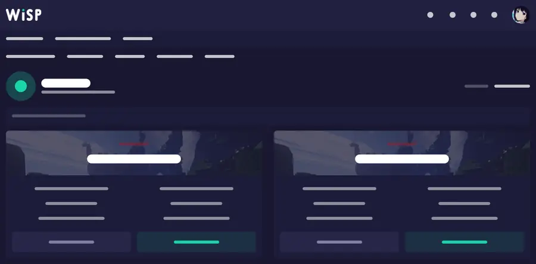

# Wisp MCP

**Administrer un panel de jeux WISP depuis un client IA compatible MCP.**

Wisp MCP communique avec l'**API Client WISP** pour lire l'état de serveurs, consulter les fichiers ou les logs et, lorsque tu l'autorises, effectuer certaines opérations d'administration. Il ne donne pas accès au système de l'hébergeur par SSH.

[English](README.md) · [Installation](docs/getting-started.md) · [Clients IA](docs/clients.md) · [Sécurité](SECURITY.md)

## Est-ce compatible avec mon hébergement ?

Ton hébergeur doit utiliser **WISP** et te permettre de créer un **token Client API**. Le panel peut être personnalisé aux couleurs de l'hébergeur.

Le projet est indépendant de l'hébergeur. Il fonctionne avec les serveurs Minecraft, Rust ou d'autres jeux gérés par un panel WISP. Ce n'est **pas** un connecteur Pterodactyl, Docker ou SSH générique.

## Fonctionnalités

- Voir les serveurs accessibles et leur consommation de ressources.
- Parcourir les dossiers, lire des fichiers et consulter les logs.
- Rechercher dans de gros fichiers ou lire seulement un passage.
- Modifier un fichier texte avec vérification SHA-256, lorsque l'écriture est autorisée.
- Envoyer une commande console ou gérer l'alimentation, si ces permissions sont activées.
- Créer, inspecter et gérer certaines sauvegardes ou bases de données, selon les permissions.

Les suppressions et restaurations sont protégées par une permission destructrice distincte. **Attention :** une commande console ou une modification de fichier peut déjà avoir des effets importants. N'active que les fonctions nécessaires et conserve une sauvegarde. Le contenu de certains fichiers et logs peut être sensible.

## Installation

Prérequis : **Python 3.11+**, Git, URL du panel WISP et token Client API.

~~~bash
git clone https://github.com/BreezeDelegate/wisp-mcp.git
cd wisp-mcp
./setup.sh
wisp-mcp doctor
~~~

Sous Windows, utilise **setup.ps1** dans PowerShell. Le token est demandé localement, sans devoir le copier dans une conversation.

Pour déployer sur un VPS Linux, consulte le [script d'installation](install-vps.sh) et le [guide VPS](docs/vps.md). Lis toujours un script avant de l'exécuter avec des privilèges élevés.

## Connecter un assistant IA

- **ChatGPT :** [configuration via tunnel sécurisé](docs/chatgpt.md).
- **Claude Code et autres clients :** [transports et exemples](docs/clients.md).

Lance le serveur en lecture seule, puis active individuellement les permissions nécessaires. Pour un accès HTTP distant, utilise TLS, un jeton d'authentification et une liste d'hôtes autorisés. Garde **WISP_ALLOW_DESTRUCTIVE=false** lors des opérations habituelles.

## Documentation

[Premiers pas](docs/getting-started.md) · [Reconnaître WISP](docs/panel-recognition.md) · [Exploitation](docs/operations.md) · [Sécurité](SECURITY.md) · [Contribuer](CONTRIBUTING.md)

## Licence

**PolyForm Noncommercial 1.0.0** : le code peut être consulté, mais la licence publique n'autorise pas l'utilisation commerciale. Voir [LICENSE](LICENSE) pour le texte intégral. Une autorisation séparée est nécessaire pour les usages commerciaux.
