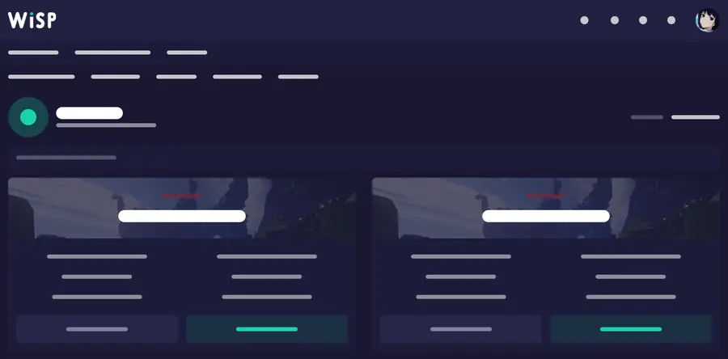

# Wisp MCP

**Use a WISP game panel from an MCP-compatible AI client.**

Wisp MCP connects to the **WISP Client API**. It can inspect game servers, read logs and files, and perform selected administrative actions through the panel. It does not provide shell access to the underlying host.

[Français](README.fr.md) · [Setup](docs/getting-started.md) · [AI clients](docs/clients.md) · [Security](SECURITY.md)

## Is this for my server?

Your hosting provider must use **WISP** and let you create a **Client API token**. The host may have customized the panel branding.

The integration works with the panel's API, regardless of which company hosts it. It can manage Minecraft, Rust, and other games exposed through the same panel. It is **not** a Pterodactyl, Docker, or general SSH integration.

## What you can do

| Task | Access |
| --- | --- |
| List servers, inspect resources and audit logs | Read |
| Browse directories, read files and search logs | Read |
| Write files, run console commands, change power state | Optional |
| Create and inspect backups; access database operations | Optional |
| Delete files, restore/delete backups, or change destructive settings | Separate destructive capability |

Large-file reads can be bounded. Existing text files support SHA-256 guarded writes, to detect changes between reading and editing. These checks do not replace a backup.

**Important:** enabling console commands or file writes can still cause harmful changes, even with the destructive capability disabled. A Client API token can also expose sensitive data in logs or configuration files. Keep tokens private and enable the smallest capabilities you need.

## Install locally

Requirements: **Python 3.11+**, Git, a WISP panel URL, and a WISP Client API token.

~~~bash
git clone https://github.com/BreezeDelegate/wisp-mcp.git
cd wisp-mcp
./setup.sh
~~~

For Windows, use **setup.ps1** in PowerShell. The setup prompts for your panel URL and token and stores them in a user-only configuration file.

Check the connection:

~~~bash
wisp-mcp doctor
~~~

This checks API access without modifying the game server. See the [step-by-step setup](docs/getting-started.md) for details.

**Linux VPS:** an optional [installer](install-vps.sh) can set up a dedicated service user. Review the script before running it with elevated privileges. The [VPS guide](docs/vps.md) covers remote deployment.

## Connect your AI client

- **ChatGPT:** follow the [secure tunnel setup](docs/chatgpt.md).
- **Claude Code:** see [client setup](docs/clients.md).
- **Other MCP clients:** use **stdio** locally or authenticated **Streamable HTTP** remotely.

Start in read-only mode. To enable specific actions later, configure the corresponding **WISP_ALLOW_*** environment flags. Keep **WISP_ALLOW_DESTRUCTIVE=false** during routine use.

The server's HTTP transport requires an allowed-host configuration when exposed remotely. Use TLS and a bearer token; avoid public unauthenticated endpoints.

## Project information

- [Configuration and operations](docs/operations.md)
- [Panel compatibility checks](docs/panel-recognition.md)
- [API compatibility checks](docs/operations.md)
- [Report a security issue](SECURITY.md)
- [Contribute](CONTRIBUTING.md)
- [Releases](https://github.com/BreezeDelegate/wisp-mcp/releases)
- [MCP Registry](https://registry.modelcontextprotocol.io/?q=io.github.BreezeDelegate%2Fwisp-mcp)

## License

**PolyForm Noncommercial 1.0.0**. The source is available, but commercial use is not granted by the public license. See [LICENSE](LICENSE) for the full terms and required notice. Commercial licensing requires separate permission from the rights holder.
